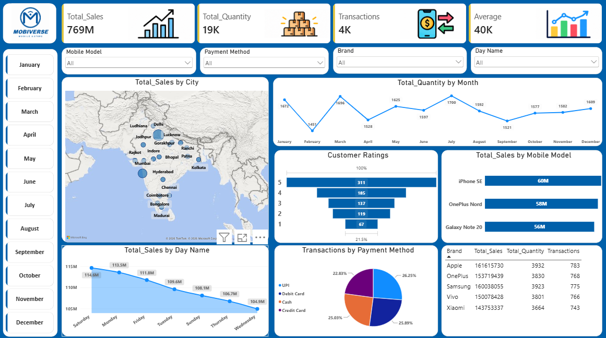

# 📱 Mobile Sales Analysis Dashboard

An end-to-end data analysis project: raw mobile sales data in Excel, cleaned and shaped in **Power Query**, and turned into an interactive **Power BI** dashboard that shows what sells, where, when and how customers pay.



---

## 📌 Table of Contents
- [Business Problem](#-business-problem)
- [Dataset](#-dataset)
- [Tools Used](#-tools-used)
- [Data Cleaning (Power Query)](#-data-cleaning-power-query)
- [Dashboard Overview](#-dashboard-overview)
- [Key Readings](#-key-readings)
- [Business Insights](#-business-insights)
- [Recommendations](#-recommendations)
- [Conclusion](#-conclusion)
- [Repository Structure](#-repository-structure)
- [How to Use](#-how-to-use)


---

## 🎯 Business Problem

A mobile retailer sells 5 brands across 19 Indian cities, but its sales sit in thousands of raw rows. There is no single view of what sells, where, when and how customers pay.

This dashboard answers four questions:

1. Which **brands and models** drive revenue?
2. Which **cities and days** bring the most sales?
3. How do **units sold move month by month**?
4. How do customers **pay**, and how do they **rate** their purchase?

---

## 🗂 Dataset

| Detail | Value |
|---|---|
| Source file | `Day_-_30_-_Mobile_Sales_Data.xlsx` |
| Transactions | 3,835 |
| Brands | 5 (Apple, Samsung, OnePlus, Vivo, Xiaomi) |
| Mobile models | 15 |
| Cities | 19 |
| Period | 2021 – 2024 |

**Columns**

| Column | Description |
|---|---|
| Transaction ID | Unique ID for each sale |
| Day, Month, Year | Date parts of the sale |
| Day Name | Day of the week |
| Brand | Phone brand |
| Mobile Model | Phone model |
| Units Sold | Quantity in the transaction |
| Price Per Unit | Selling price of one unit |
| Customer Name | Name of the customer |
| Customer Age | Age of the customer (18 – 59) |
| City | City of the sale |
| Payment Method | UPI, Debit Card, Credit Card or Cash |
| Customer Ratings | Rating from 1 to 5 |

---

## 🛠 Tools Used

- **Microsoft Excel**: raw data source
- **Power Query**: data cleaning and transformation
- **Power BI Desktop**: data model, measures and dashboard

---

## 🧹 Data Cleaning (Power Query)

The raw file was cleaned and shaped in Power Query before loading into Power BI (table: `Sales_Data`):

- Standardised inconsistent **Day Name** values (for example `Sat` → `Saturday`, `Sun` → `Sunday`)
- Set correct data types for numeric, text and date columns
- Built a proper **Date** column from the Day, Month and Year columns, used for the month slicer and trend chart
- Checked for missing values and duplicate transactions (none found)

> ✏️ Add or remove steps here so the list matches your Applied Steps in Power Query.

---

## 📊 Dashboard Overview

The single-page dashboard contains:

**KPI cards**
- `Total_Sales`, `Total_Quantity`, `Transactions` and `Average`

**Visuals**

| Visual | Purpose |
|---|---|
| Map | Total sales by city |
| Line chart | Total quantity by month |
| Funnel | Customer ratings (1 to 5 stars) |
| Bar chart | Total sales by mobile model |
| Area chart | Total sales by day of the week |
| Pie chart | Transactions by payment method |
| Table | Brand-wise sales, quantity and transactions |

**Interactive filters**
- Slicers: Mobile Model, Payment Method, Brand and Day Name
- Month buttons (January to December) to filter the whole page

---

## 🔍 Key Readings

| Metric | Reading |
|---|---|
| Total Sales | **₹769M** |
| Total Quantity | **19K units** (19,150) |
| Transactions | **4K** (3,835) |
| Average | **₹40K** per unit |
| Avg. per transaction | About **₹200K** and **5 units** |
| Best month (units) | July (1,700), followed by March (1,696) and January (1,672) |
| Weakest month (units) | February (1,451) |
| Best day (sales) | Saturday (₹114.6M) |
| Weakest day (sales) | Wednesday (₹104.9M) |
| Top brand | Apple (₹161.6M), then Samsung (₹160.0M) |
| Lowest brand | Xiaomi (₹143.8M) |
| Top models | iPhone SE (₹60M), OnePlus Nord (₹58M), Galaxy Note 20 (₹56M) |
| Top cities | Delhi (₹203.9M) and Mumbai (₹127.2M) |
| Payment split | UPI 26.25%, Debit Card 25.89%, Cash 25.03%, Credit Card 22.83% |
| Ratings | 5-star is the largest group, about 61% of ratings are 4 or 5 stars |

---

## 💡 Business Insights

1. **Two metros carry the business.** Delhi and Mumbai deliver about 43% of revenue. The other 17 cities contribute only ₹23M to ₹31M each.
2. **No single brand dependence.** Apple leads with about 21%, but all five brands sit within 12% of each other.
3. **Steady demand, no festive spike.** Monthly units stay between 1,451 and 1,700, and Oct to Dec look like any other month.
4. **Small weekly pattern.** Saturday, Monday and Friday lead, while Wednesday and Thursday are weakest. The best-to-worst day gap is only about 9%.
5. **Payments and ratings have room to improve.** UPI leads while credit card lags, and about 1 in 5 ratings is only 1 or 2 stars.

---

## ✅ Recommendations

1. **Grow beyond Delhi and Mumbai.** Pilot targeted offers and stock in the next-best cities (Ranchi, Chennai, Rajkot, Jodhpur).
2. **Build a festive-season push.** Launch exchange and bundle offers for Oct to Dec.
3. **Time promotions around the week.** Run flash deals on Wednesday and Thursday, and stock up for Friday to Monday.
4. **Nudge payment behaviour.** Reward UPI with cashback and add no-cost EMI to lift credit card usage.
5. **Back winners, fix laggards.** Push top models, review the weakest ones (Redmi 9, Vivo S1) and follow up on 1 to 2 star orders.

---

## 🏁 Conclusion

The business is healthy and well balanced: ₹769M from 19K units with no brand dependence. The next stage of growth depends on broadening beyond two metros, lifting off-peak periods and improving the payment and satisfaction experience.

---

## 📁 Repository Structure

```
├── README.md
├── Mobile_Sales_Dashboard.pbix              # Power BI report
├── data/
│   └── Mobile_Sales_Data.xlsx    # Raw dataset
├── images/
│   └── dashboard.png                        # Dashboard screenshot
└── presentation/
    └── Mobile_Sales_Analysis_Dashboard.pptx # Project presentation
```

---

## ▶️ How to Use

1. Clone or download this repository.
2. Open `Mobile_Sales_Dashboard.pbix` in **Power BI Desktop**.
3. If Power BI cannot find the data, go to **Home → Transform data → Data source settings** and point it to the Excel file in the `data/` folder.
4. Use the slicers and month buttons to explore the data.


⭐ If you found this project useful, consider giving the repo a star.
